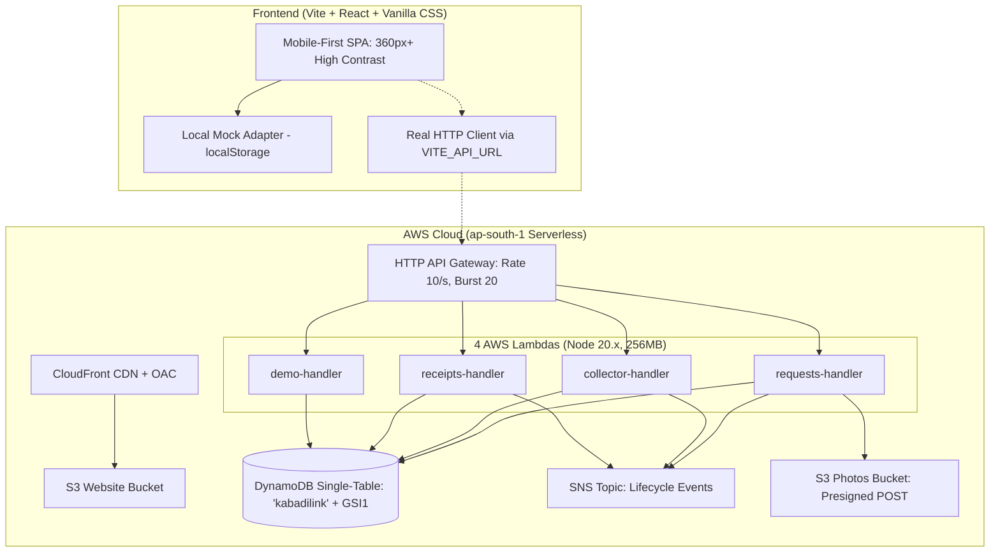

# ⚡ KabadiLink (कबाड़ीलिंक)

> **Pickup apps for e-waste already exist. KabadiLink builds the missing verifiable paper trail between households, informal scrap collectors (*kabadiwalas*), and authorised recyclers under India's E-Waste Rules 2022.**

[](file:///c:/Users/shrim/OneDrive/Desktop/Event%202/vitest.config.ts)
[](file:///c:/Users/shrim/OneDrive/Desktop/Event%202/template.yaml)
[](file:///c:/Users/shrim/OneDrive/Desktop/Event%202/template.yaml)
[](file:///c:/Users/shrim/OneDrive/Desktop/Event%202/tsconfig.json)
[](#-zero-setup-quickstart-offline--free)

---

## 🎯 The Problem vs. The Solution

In India, **over 95% of e-waste** flows through the informal sector—local *kabadiwalas* who collect scrap doorstep-by-doorstep. 

Under the **E-Waste (Management) Rules 2022**, registered recyclers are legally required to verify the origin and weight of every batch they purchase to issue Extended Producer Responsibility (EPR) credits. According to the **CPCB FAQ**, when a recycler buys from an informal seller, they need a **traceable sales receipt** documenting the seller's name, locality, weight, and date.

```
┌──────────────┐       Informal Doorstep       ┌─────────────────┐       Formal Facility       ┌───────────────────────┐
│  Household   │ ────────────────────────────> │ Scrap Collector │ ──────────────────────────> │  Authorised Recycler  │
│  (Resident)  │    Pickup OTP & Weight        │  (Kabadiwala)   │     Cryptographic Receipt   │     (Sample Yard)     │
└──────────────┘                               └─────────────────┘                             └───────────────────────┘
                                                        │
                                                        ▼
                                       ┌──────────────────────────────────┐
                                       │    Public SHA-256 Verification   │
                                       │   "Unchanged Since Issuance"     │
                                       └──────────────────────────────────┘
```

| ❌ The Old Way (Informal Void) | ✅ The KabadiLink Way |
| :--- | :--- |
| Scrap sold with cash; zero paper trail | Verifiable digital sales proof receipt issued upon facility delivery |
| Recyclers cannot verify source or origin | Verified timeline tracing resident locality, collector, and intake weight |
| Personal data on old phones/laptops risks leakage | Mandatory data wipe declaration for all data-bearing electronics |
| Loose hazardous batteries dumped in scrap piles | Automatic rejection of loose batteries with direction to battery centers |
| Duplicate trip pickups by competing collectors | Concurrency-locked conditional writes (`HTTP 409 Conflict` prevention) |

---

## 🚀 Zero-Setup Quickstart (Offline & Free)

KabadiLink features a **zero-dependency in-browser mock engine (`localStorage`)** allowing instant evaluation without requiring any live AWS deployment or external API keys.

### 1. Clone & Install
```bash
git clone https://github.com/shrimantved-sys/Kabadilink.git
cd Kabadilink
npm install
```

### 2. Run the Frontend (Instant In-Browser Demo)
```bash
cd frontend
npm install
npm run dev
```

Open **`http://localhost:5173`** in your browser. The application loads with **6 pre-seeded requests across all lifecycle states**, 3 scrap collectors, and 4 sample recyclers!

### 3. Run Backend Unit Tests (100% Offline)
```bash
# In the root repository
npm test
```
*Executes all 17 unit tests verifying status transitions, race-condition double accepts, SHA-256 fingerprint creation, loose battery blocking, and weight estimation.*

---

## 📱 User Flows & Features

### 1. 🏠 Household Portal (`/household/new`, `/household/track`)
- **Smart Category Selection**: Add up to 10 line items across 10 categories with auto-calculated estimated weights.
- **Data Privacy Gate**: Mandatory checkbox confirmation for phones, laptops, and tablets: *"I have removed personal data or will before pickup."*
- **Strict Battery Safety**: Rejects loose batteries (`battery_loose`) with instant guidance: *"Loose batteries are not accepted in this prototype. Please take them to an authorised battery collection point."*
- **On-Screen SMS Preview**: Shows the 6-character Request Code (`KL-XXXXXX`) and secret **4-digit Pickup OTP**.
- **Phone Privacy**: Phone numbers remain masked (`+91 ******XXXX`) until a collector has formally accepted the trip.

### 2. 🛵 Scrap Collector Portal (`/collector`)
- **Kabadiwala-First UX**: Big touch buttons, icons, high contrast, and **zero confusing data tables**.
- **Batch Locality Acceptance**: View open requests aggregated by locality with estimated weights and **illustrative scrap payout rates**. Accept multiple pickups in one trip.
- **Doorstep Verification (`/collector/pickup/:id`)**: Enters the resident's 4-digit OTP and confirms actual scale weight (0.1 - 200 kg).
- **Recycler Handover (`/collector/handover/:id`)**: Selects an authorised sample recycler (filtered by accepted e-waste categories) to generate the tamper-proof receipt.

### 3. 📜 Cryptographic Receipt (`/receipt/:id`)
- Displays household first name, masked phone, locality, actual weight, collector details, and sample recycler registration number.
- Computes an **immutable SHA-256 digital fingerprint** across canonical sorted JSON keys (`KL-FP-XXXX-XXXX`).
- Features a printable **A4 stylesheet** and an embedded QR code linking to public verification.

### 4. 🛡️ Public Verification Portal (`/verify/:id`)
- Anyone who scans the receipt QR code can verify its authenticity.
- Dynamically recomputes the SHA-256 hash against the database snapshot and displays:
  - `✓ Fingerprint Verified: Receipt data is authentic and unchanged since issuance.`
- **Zero Privacy Leakage**: Household phone numbers and street addresses are strictly omitted from public view.

### 5. ⚙️ Demo Control Panel (`/demo`)
- One-click **Seed Demo Data** (pre-loads 6 requests across all states).
- One-click **Reset Database** (clears prototype data).
- **Simulate Recycler Intake**: Simulates the authorised recycler confirming intake at the physical yard (labelled `SIMULATED`).

### 6. 🌐 Real-Time Bilingual Toggle (English + हिंदी)
- Every screen includes an instant language switcher between English and concise, colloquial Hindi.

---

## 🏗️ Architecture & Serverless Stack



---

## ☁️ Live AWS Cloud Deployment

Deploy the serverless backend to AWS in region `ap-south-1` using the [AWS Serverless Application Model (SAM)](file:///c:/Users/shrim/OneDrive/Desktop/Event%202/template.yaml).

### Prerequisites:
1. [AWS CLI](https://aws.amazon.com/cli/) configured (`aws configure` with region `ap-south-1`).
2. [AWS SAM CLI](https://aws.amazon.com/serverless/sam/) installed.

### 1. Build and Deploy
```bash
# Build Lambda artifacts
sam build

# Deploy to AWS Cloud
sam deploy --guided
```
*During `sam deploy --guided`, accept defaults (Stack Name: `kabadilink`, Region: `ap-south-1`, Allow SAM to create IAM roles).*

### 2. Connect Frontend to the Deployed Cloud API
When SAM completes deployment, note the `HttpApiUrl` output:
```text
Outputs:
HttpApiUrl = https://abc123xyz.execute-api.ap-south-1.amazonaws.com
```

Create `frontend/.env`:
```env
VITE_API_URL=https://abc123xyz.execute-api.ap-south-1.amazonaws.com
```

Build the frontend bundle:
```bash
cd frontend
npm run build
```

> **CloudFront Deployment Note**:
> If CloudFront distribution provisioning takes several minutes, you can run the frontend locally connected directly to your live AWS API:
> ```bash
> cd frontend
> npm run dev
> ```
> The app will immediately execute live reads and writes against your real DynamoDB table and Lambdas!

---

## 🧪 Automated Smoke Test Walkthrough

Validate the complete end-to-end happy path against your live deployed API:

### Bash / Linux / macOS:
```bash
chmod +x scripts/smoke.sh
./scripts/smoke.sh "https://abc123xyz.execute-api.ap-south-1.amazonaws.com"
```

### Windows PowerShell:
```powershell
.\scripts\smoke.ps1 -ApiUrl "https://abc123xyz.execute-api.ap-south-1.amazonaws.com"
```

The script runs a 10-step verification test:
1. Seeds demo data (`POST /demo/seed`)
2. Fetches sample recyclers (`GET /recyclers`)
3. Lists open collector requests (`GET /collector/requests`)
4. Creates a new household pickup (`POST /requests`)
5. Reads tracking status (`GET /requests/{id}`)
6. Accepts the batch trip as collector `COL-01` (`POST /collector/accept`)
7. Confirms OTP pickup & scale weight (`POST /collector/requests/{id}/pickup`)
8. Hands over to authorised recycler (`POST /collector/requests/{id}/handover`)
9. Retrieves generated receipt (`GET /receipts/{id}`)
10. Validates public SHA-256 cryptographic tamper check (`GET /verify/{id}`)

---

## 💰 Cloud Cost Analysis & Billing Alarm

Because KabadiLink uses **100% On-Demand / Pay-Per-Request Serverless primitives**, idle running costs are **₹0.00 / $0.00**:

- **DynamoDB**: On-Demand capacity (`PAY_PER_REQUEST`). No hourly baseline fee.
- **AWS Lambda**: 1 million free requests per month on AWS Free Tier.
- **HTTP API Gateway**: 1 million free calls per month.
- **S3 & CloudFront**: Free tier eligible.

### Setting a CloudWatch Billing Alarm ($5 USD threshold):
To ensure you never incur unexpected charges, run this command using the AWS CLI:
```bash
aws cloudwatch put-metric-alarm \
  --alarm-name "KabadiLink-Billing-Alarm" \
  --metric-name EstimatedCharges \
  --namespace AWS/Billing \
  --statistic Maximum \
  --period 21600 \
  --threshold 5.0 \
  --comparison-operator GreaterThanOrEqualToThreshold \
  --dimensions Name=Currency,Value=USD \
  --evaluation-periods 1 \
  --region us-east-1
```

---

## 🧹 Clean Teardown

To delete all provisioned AWS cloud resources (DynamoDB table, Lambdas, API Gateway, S3 buckets, and SNS topics) without leaving any orphaned infrastructure:

```bash
sam delete --stack-name kabadilink --no-prompts
```

---

## 📚 Documentation Index

- [docs/ARCHITECTURE.md](file:///c:/Users/shrim/OneDrive/Desktop/Event%202/docs/ARCHITECTURE.md): Complete Single-Table schema, sparse GSI1 index lifecycle, and concurrency control specifications.
- [docs/DEMO_SCRIPT.md](file:///c:/Users/shrim/OneDrive/Desktop/Event%202/docs/DEMO_SCRIPT.md): Step-by-step 3-minute hackathon judge walkthrough.
- [docs/LIMITS.md](file:///c:/Users/shrim/OneDrive/Desktop/Event%202/docs/LIMITS.md): Transparent disclosures regarding prototype boundaries, simulated SMS, and sample data.

---

## ⚖️ Legal & Regulatory Disclaimer

*KabadiLink is a hackathon prototype designed to model verifiable sales proof receipts under India's E-Waste (Management) Rules 2022. It is **NOT** integrated with the central CPCB portal and does **NOT** generate official Extended Producer Responsibility (EPR) certificates. All recyclers and registration numbers displayed are fictional sample data.*

---

Made with ⚡ for sustainable, transparent e-waste recycling.
